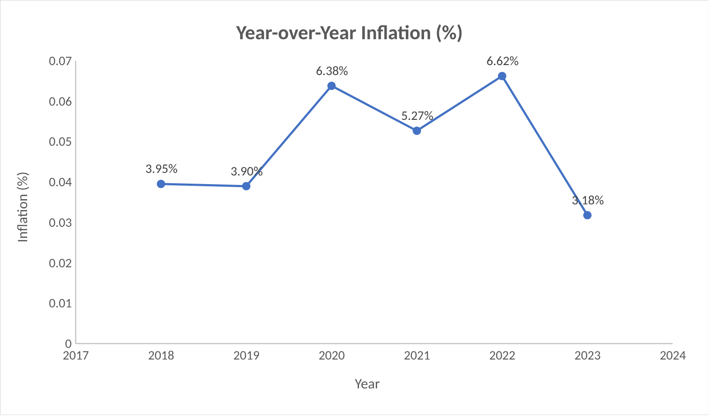
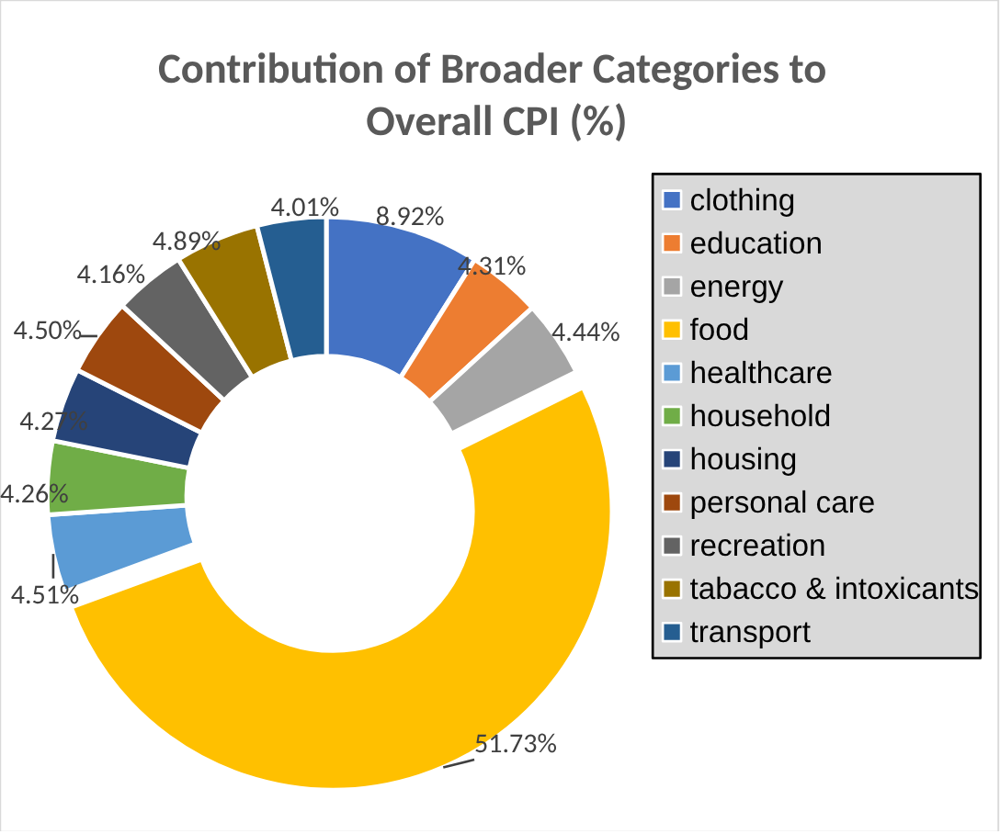
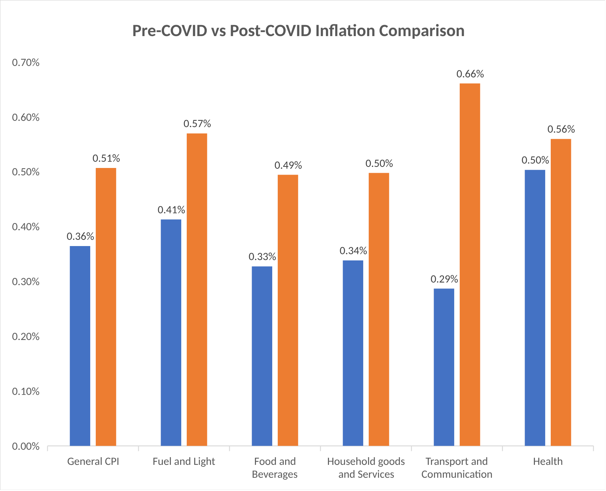
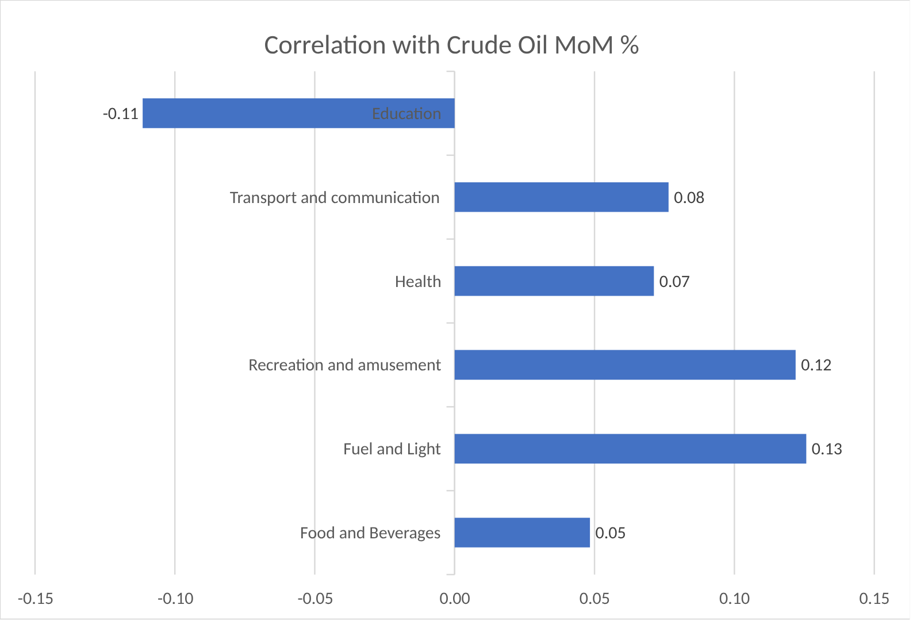
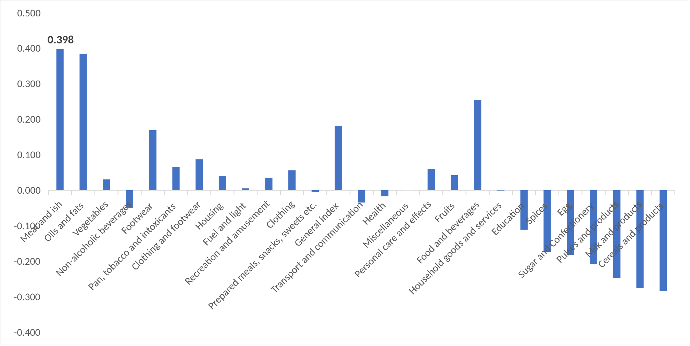

# CPI Inflation Analysis: India 2017–2023


An Excel analysis of India's **Consumer Price Index (CPI)**: what drives the basket, how inflation moved through COVID-19 and the 2022 price shock, which food items swung the most, and whether crude oil prices pass through to consumer prices. It uses official All-India CPI data (base year 2012 = 100) for **23 sub-categories** across rural, urban and combined sectors.

- **What I did:** Analysed official CPI data (23 categories, 2013 to 2023) for what drives India's prices, what COVID changed and whether crude oil matters.
- **What I found:** **Inflation peaked at 6.62% in 2022.** After COVID, transport prices rose fastest, and crude oil barely moves consumer prices.
- **Why it matters:** To read where inflation is heading, watch transport and food prices, not crude oil.

**📊 [Download the Excel workbook](CPI_Project.xlsx)** · **📄 [One-page project summary (PDF)](CPI_Project_Summary.pdf)** · **[Interactive case file](https://parthdhawan921-ops.github.io/Parth_Personal/#cpi)**



---

## 📑 Contents

- [Key Findings](#-key-findings)
- [Dataset](#-dataset)
- [Analysis](#-analysis)
- [Skills Demonstrated](#-skills-demonstrated)
- [Limitations](#️-limitations)
- [Repository Structure](#-repository-structure)
- [Author](#-author)

---

## 💡 Key Findings

| | Finding |
|---|---|
| **Highest inflation** | **2022: 6.62%**, driven by oil prices, the Russia–Ukraine war and lingering COVID supply shocks |
| **Latest inflation** | **2023: 3.18%** (Jan–May), as supply recovered and oil prices stabilised |
| **High-inflation period** | 2020–2022 averaged above 5% a year, against ~3.9% in 2018–2019 |
| **Biggest share of the CPI basket** | **Food: 51.73%** of summed sub-category index points (May 2023) |
| **Food price spike** | **Oct 2022: +1.01%** month-on-month (festival demand plus an uneven monsoon withdrawal) |
| **Food price relief** | **Dec 2022: −1.35%** month-on-month (winter vegetable harvest) |
| **Biggest food mover** | **Spices +30.9 points** (Jun 2022 → May 2023); Oils & fats −30.9 and Vegetables −21.3 |
| **After COVID** | Average monthly inflation rose in every category tested. **Transport & communication rose most** (0.29% → 0.66% a month) |
| **Crude oil link** | **Weak.** Fuel & light 0.13 is the highest category correlation; Meat & fish 0.398 is the highest sub-category |

**What stands out**

- **COVID set off a three-year inflation cycle.** Disrupted supply met a fast return of demand, and prices stayed high until 2023.
- **Food is volatile in both directions.** Seasonal harvests and weather moved food prices more than any single shock: spices surged while edible oils fell as global export bans were lifted.
- **Oil prices don't pass straight through.** Even fuel & light shows only a weak monthly correlation with crude oil. This is likely because retail fuel and electricity prices in India are regulated and taxed, which smooths out swings in world prices.

---

## 📊 Dataset

[`data/All_India_CPI_Index_2013_2023.csv`](data/All_India_CPI_Index_2013_2023.csv) is the official **All-India CPI** published by MoSPI (Ministry of Statistics and Programme Implementation):

| | |
|---|---|
| **Period** | Jan 2013 – May 2023 (monthly) |
| **Sectors** | Rural, Urban, Rural + Urban (372 rows) |
| **Measures** | 23 sub-category indices (cereals, vegetables, fuel and light, health, education, …), group indices and the General Index |
| **Base** | 2012 = 100 |

The workbook maps the 23 sub-categories to **11 broader categories** (food, energy, clothing, housing, healthcare, transport, …). For the oil analysis it adds monthly **crude oil prices** (USD/barrel, Jan 2021 – May 2023).

---

## 🔍 Analysis

The workbook is organised as one sheet per question, each with its own table, chart and written insight.

### 1. Category contribution to CPI (`Ques 1`)
A pivot table groups the sub-categories into broader categories for the latest month (May 2023). **Food** makes up just over half of the summed index points; every other category is 4–9%.



### 2. Year-over-year inflation (`Ques 2`)
Annual average General Index (Rural + Urban) gives YoY inflation for 2018–2023: **3.95% → 3.90% → 6.38% → 5.27% → 6.62% → 3.18%**.

### 3. Food inflation and sub-category changes (`Ques3 A`, `Ques3 B`)
Month-on-month food inflation from June 2022 to May 2023, with the reason behind each peak and trough. The absolute change of all 12 food sub-categories over the same period shows spices up 30.9 points and oils & fats down 30.9.

### 4. COVID-19 impact (`Ques 4`)
Average monthly inflation **before COVID (Mar 2017 – Mar 2020, blue)** vs **after (Apr 2020 – Mar 2023, orange)** for the General Index and five key categories.



### 5. Crude oil vs CPI (`Ques 5 Category`, `Ques 5 Subategory`)
`CORREL` between crude oil's monthly % change and each CPI series' monthly % change (2021–2023), at both category and sub-category level.

| Category level | Sub-category level |
|---|---|
|  |  |

---

## 🧠 Skills Demonstrated

| Area | Techniques |
|---|---|
| **Data preparation** | Category mapping with `VLOOKUP`, reshaping by sector and period, month-over-month % change columns |
| **Analysis** | Pivot tables, YoY and MoM growth rates, absolute change, period averages with `AVERAGE` |
| **Statistics** | Correlation analysis with `CORREL` (33 correlations), interpreting correlation strength |
| **Visualisation** | Doughnut, line, clustered column and bar charts with data labels |
| **Communication** | An insight and economic explanation next to every result, plus a one-page executive summary |

---

## ⚠️ Limitations

- **Contribution isn't the official weighting.** The category share is based on summed index *points*, so groups with more sub-categories count for more (food has 12 of 23). The official CPI weight for food & beverages is about 45.9%.
- **Partial years.** 2017 starts in March and 2023 ends in May, so their annual averages cover fewer months.
- **Missing months in the source data.** April 2019 is absent, and the General Index is blank for April–May 2020 (CPI collection was disrupted by the lockdown).
- **Correlation isn't causation**, and monthly correlations over ~28 months are sensitive to a few large moves.

---

## 📂 Repository Structure

```text
.
├── CPI_Project.xlsx                  # Workbook: data, pivot tables, charts, insights (one sheet per question)
├── CPI_Project_Summary.pdf           # One-page executive summary
├── data/
│   └── All_India_CPI_Index_2013_2023.csv   # Raw MoSPI CPI data
├── images/                           # Charts exported from the workbook
└── README.md
```

> The doughnut chart in this README plots the 11 categories only. In the workbook, the chart's data range (`D8:E20`) also picks up the pivot table's Grand Total row.

---

## 👨‍💻 Author

**Parth Dhawan**: Data Analyst · SQL · Python · Excel · Power BI

[GitHub](https://github.com/parthdhawan921-ops) · [LinkedIn](https://www.linkedin.com/in/parth-dhawan-31516127a/)
